> Estado actual: consulta la sección final de tema y navegación (39–54), la de autenticación y [sus capturas reales](Autenticacion.html). Las evidencias 01–29 conservan versiones anteriores del código. Los paquetes están en inglés.

# Informe de desarrollo — primera entrega DSY1105 / 007D

Proyecto: Gestión móvil de oportunidades y activaciones corporativas.

Implementación Android nativa: Kotlin, Jetpack Compose, Material 3, MVVM, Room y StateFlow.
Fecha: 18 de octubre de 2026. Desarrollo apoyado con IA; el equipo debe revisar y validar la entrega.

## Alcance y estado de la evidencia de la primera entrega

Se implementó el módulo de oportunidades. El acceso es una demostración con identidad ficticia;
la autenticación completa y los demás módulos del caso se reservan para avances posteriores.

Las imágenes 01–29 son capturas de un visor del código fuente real del proyecto.
**No son capturas de Android Studio ni de la aplicación ejecutándose.** Cada captura identifica
el archivo y las líneas mostradas. Se incluyen explicaciones y resultados para distinguir
implementación, compilación, pruebas unitarias y pruebas pendientes.

En la primera entrega, el emulador Pixel_7_API_34 no inició: Android Emulator 37.2.12 rechazó HAXM y solicitó WHPX.
También falló el intento sin aceleración. No había un teléfono Android conectado.
Por tanto, no se verificaron visualmente la app, los permisos, la lectura óptica de QR ni
la persistencia después de reiniciar el proceso. No se alteró la configuración de Windows.

La ubicación es una referencia ficticia opcional de Puente Alto, permitida por el caso.
No es una lectura del GPS. Si el docente exige la fila de ubicación del dispositivo
literalmente, ese recurso debe añadirse/probarse; la cámara es el recurso nativo implementado.

## Hitos del desarrollo

### Organización del proyecto

**Implementación:** Paquetes separados para datos locales, repositorio, pantallas, navegación y utilidades.

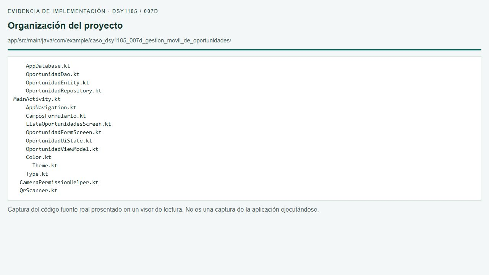

**Resultado y verificación:** Se inspeccionaron los archivos y se compilaron las clases de la aplicación.

### Arquitectura MVVM

**Implementación:** Las pantallas reciben estado y callbacks. OportunidadViewModel procesa eventos, valida y utiliza OportunidadRepository; el repositorio utiliza el DAO.

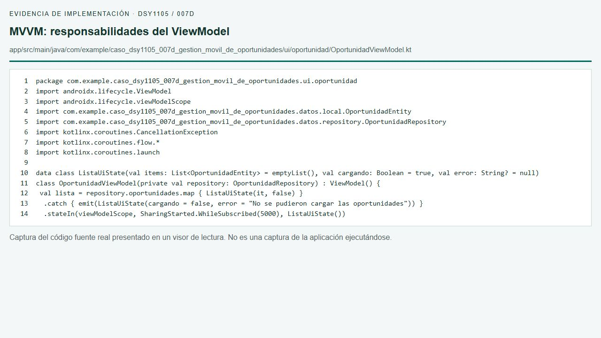

**Resultado y verificación:** Las pruebas del ViewModel comprueban validación, guardado, edición, error y prevención de envíos duplicados.

### Navegación

**Implementación:** MainActivity construye el repositorio y abre AppNavigation. Rutas: acceso, menú, lista, formulario con id y lector QR.

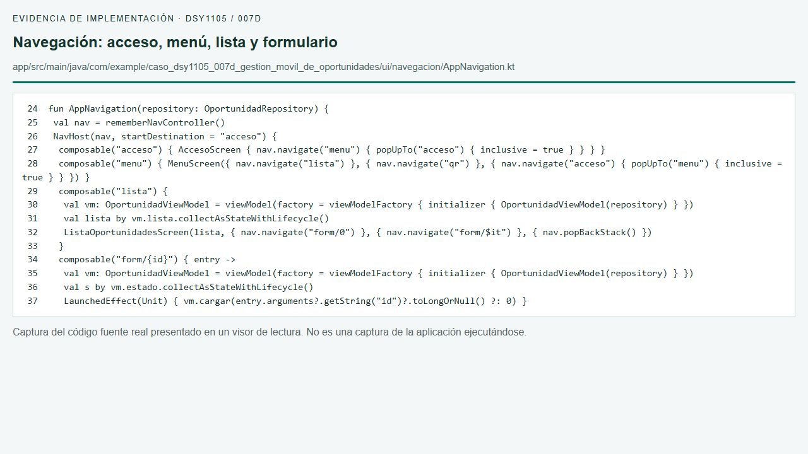

**Resultado y verificación:** Las rutas y pantallas compilan. La ejecución de la secuencia completa en dispositivo sigue pendiente.

### Listado de oportunidades

**Implementación:** La lista presenta nombre, tipo, prioridad, potencial y estado; permite crear y abrir un registro para editar. Incluye estados vacío, carga y error.

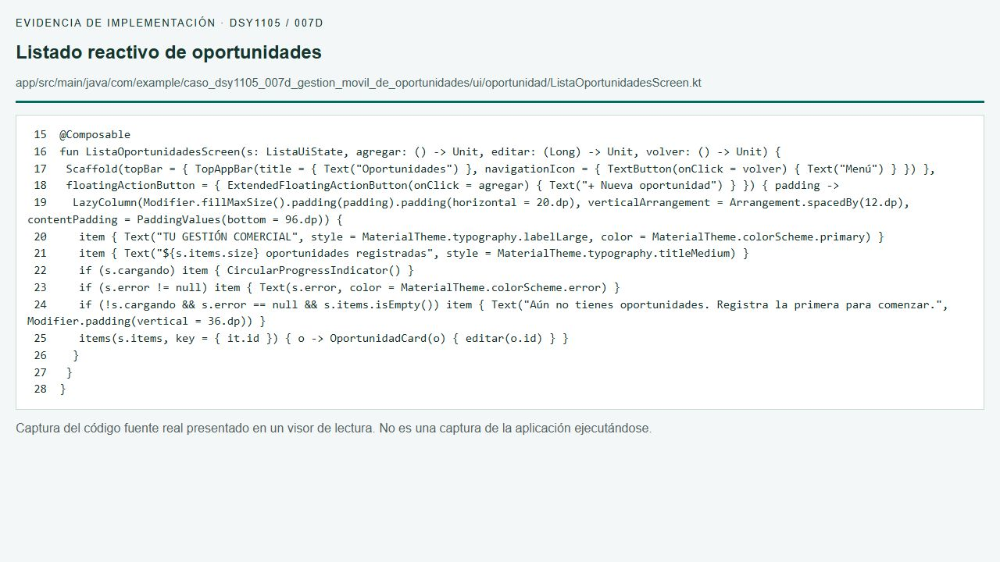

**Resultado y verificación:** Componente compilado y previews definidos. La prueba de interfaz está compilada, pendiente de ejecución.

### Registro y edición

**Implementación:** Formulario con nombre, tipo, descripción, fuente, prioridad, potencial, estado, observaciones y referencia geográfica ficticia opcional.

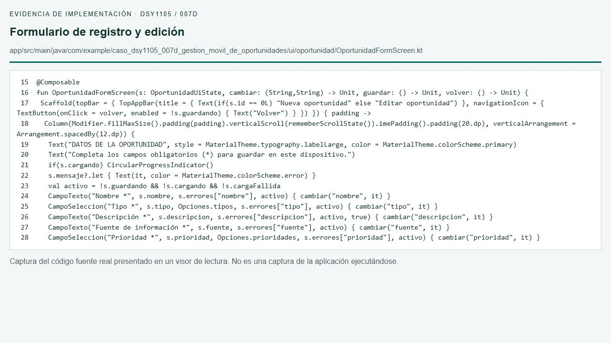

**Resultado y verificación:** Las pruebas de lógica verifican que editar conserva el identificador y la fecha de detección. Falta verificación visual en Android.

### Validaciones

**Implementación:** Se rechazan campos obligatorios vacíos o compuestos por espacios y valores ajenos a las opciones permitidas. Los errores se guardan en UiState y se muestran junto a los campos.

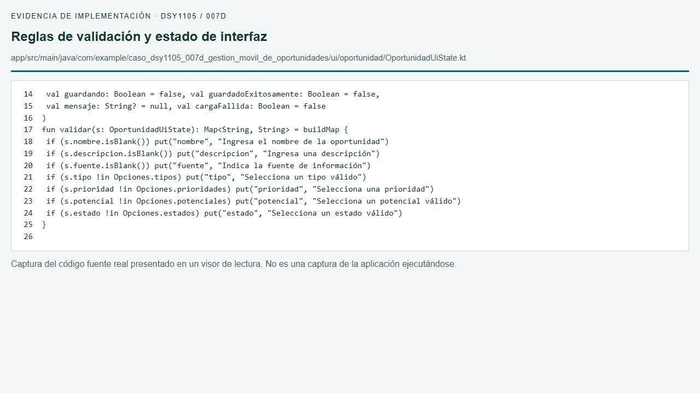

**Resultado y verificación:** Las pruebas unitarias verifican campos obligatorios, espacios y opciones inválidas. La evidencia visual de los mensajes en la app queda pendiente.

### Persistencia con Room

**Implementación:** Base de datos oportunidades.db, entidad con identificador autogenerado, inserción, consulta y actualización. Esquema exportado en app/schemas.

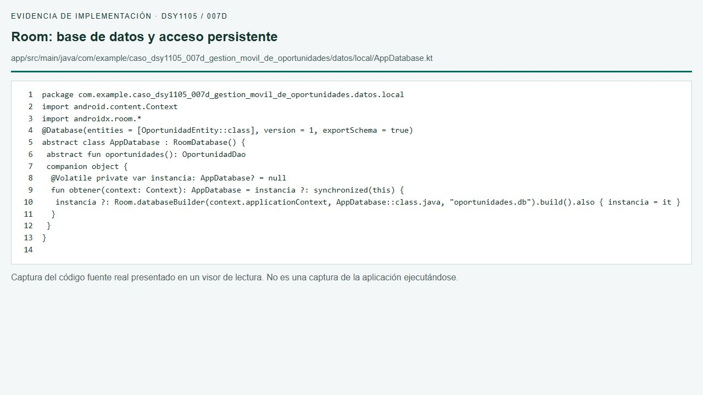

**Resultado y verificación:** Room generó su implementación y la aplicación compila. La prueba que cierra y reabre la base está compilada, pero no se ha ejecutado en dispositivo.

### UiState, StateFlow y Flow

**Implementación:** El DAO devuelve Flow; el ViewModel expone StateFlow; Compose observa con collectAsStateWithLifecycle. Guardado y errores forman parte del estado.

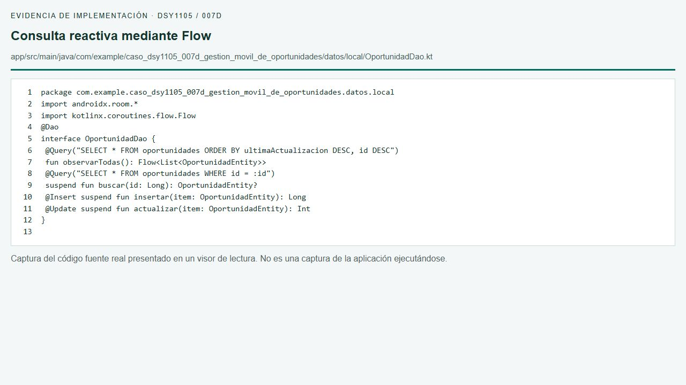

**Resultado y verificación:** El cableado reactivo compila. La actualización visual de la lista después de guardar está cubierta por una prueba de interfaz aún pendiente de ejecución.

### Recurso nativo: cámara y QR

**Implementación:** CameraX y ML Kit leen códigos OPORTUNIDAD:<id>. Se solicita permiso de cámara, se controla el formato y se abre el registro local.

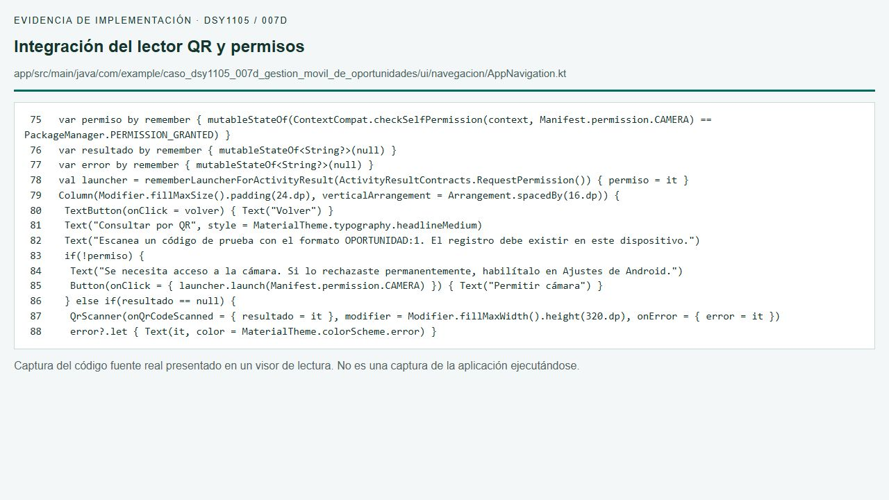

**Resultado y verificación:** La función de interpretación de QR pasó pruebas unitarias. Permisos, captura de cámara y reconocimiento óptico requieren prueba en Android.

### Pruebas del desarrollo

**Implementación:** Diez pruebas nuevas de lógica, además de las pruebas base del proyecto. Pruebas instrumentadas preparadas para flujo completo y persistencia real.

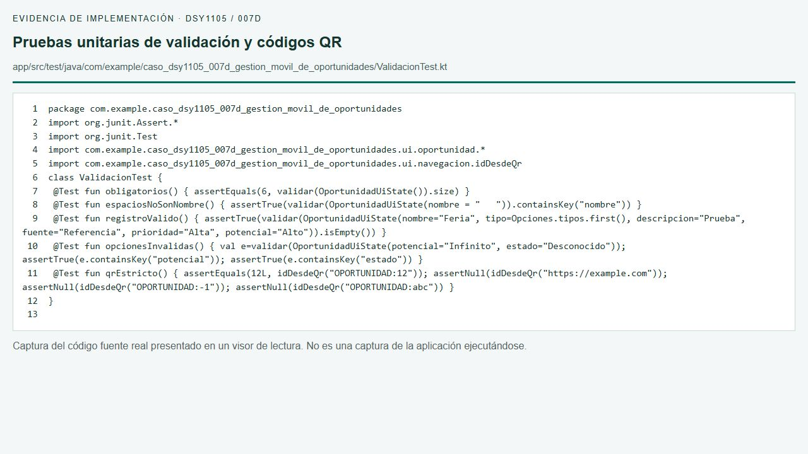

**Resultado y verificación:** Consultar los XML y verificacion-build.txt de esta carpeta para resultados exactos. No se presenta una prueba instrumentada compilada como ejecutada.

### Previews por componente visual

**Implementación:** Vistas previas para acceso, menú, lista con datos y vacía, tarjeta, campos, formulario normal y con errores, cámara y tema.

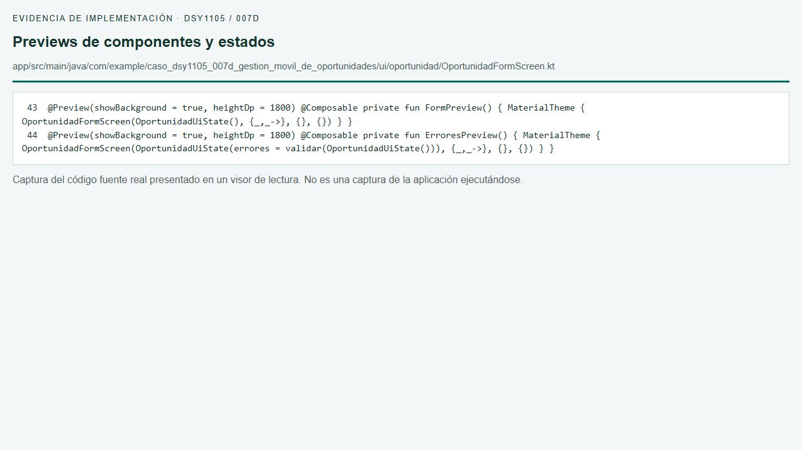

**Resultado y verificación:** Las funciones Preview compilan. El lector usa LocalInspectionMode para evitar abrir la cámara en el editor. AppNavigation es el contenedor de integración; sus pantallas tienen previews independientes.

## Comprobaciones y pendientes para la entrega

- Consultar `verificacion-build.txt` para el resultado de compilación, pruebas y lint.
- Abrir los previews en Android Studio y revisar tamaños de texto, teclado y desplazamiento.
- Ejecutar `gradlew.bat connectedDebugAndroidTest` con un dispositivo de prueba disponible.
- La prueba `flujoCompleto` guarda capturas en la carpeta externa de la app: `files/Evidencia`.
- Copiar esas capturas a esta carpeta, preservando las evidencias de código.
- Crear una oportunidad, cerrarla completamente y volver a abrir la aplicación: comprobar que permanece.
- Modificarla y comprobar que se mantiene un único registro y se actualiza la lista.
- Probar QR válido, inválido, registro inexistente y permisos de cámara concedidos/rechazados.
- Revisar los datos y explicaciones del informe antes de presentarlo.
- Cada integrante debe realizar y registrar sus contribuciones. No se crearon commits atribuidos a terceros.

## Guion manual de demostración

1. Iniciar sesión de prueba y abrir Oportunidades.
2. Crear una oportunidad; intentar guardar vacía y revisar errores.
3. Completar los campos obligatorios y guardar.
4. Abrir el registro, modificar prioridad/estado y guardar.
5. Cerrar y reiniciar la aplicación; volver al listado.
6. Abrir el registro y anotar el texto OPORTUNIDAD:<id>.
7. Escanear un QR con ese texto desde el menú; consultar el registro.
8. Repetir con un QR inválido y con un identificador inexistente.

## Referencias de alcance

- Lineamientos 007D.pdf, primera entrega: oportunidades, MVVM, Room, validaciones, navegación y evidencias.
- Caso_DSY1105_007D_Gestión móvil de oportunidades y activaciones corporativas.pdf: tipos, estados, datos ficticios y alcance académico.

## Resultado final de la verificación

VERIFICACIÓN REAL DEL PROYECTO

ExampleUnitTest: 1 pruebas; 0 fallos; 0 errores
OportunidadViewModelTest: 5 pruebas; 0 fallos; 0 errores
ValidacionTest: 5 pruebas; 0 fallos; 0 errores

Compilación: BUILD SUCCESSFUL
APK de aplicación: generado
APK de pruebas instrumentadas: generado, no ejecutado
Lint: 0 errores, 26 advertencias

Ejecución Android: pendiente (emulador incompatible con HAXM).
No se generaron capturas de la aplicación ejecutándose.

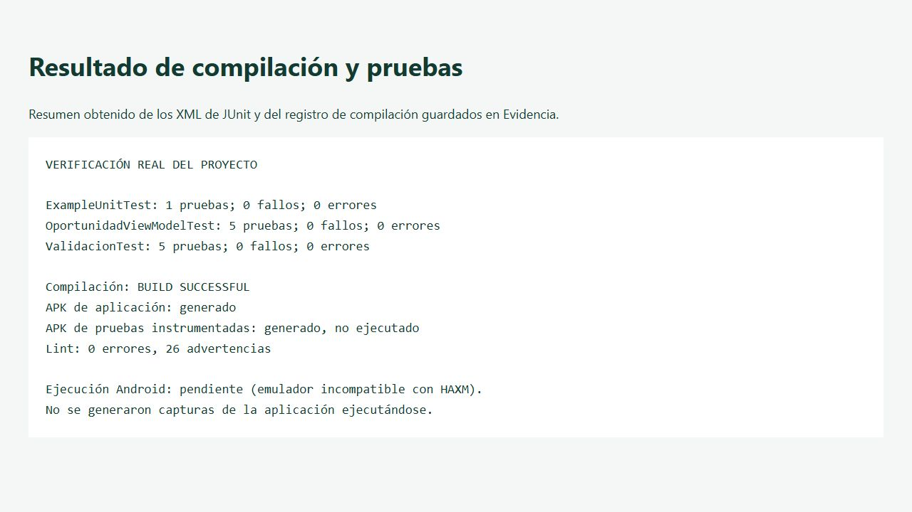

## Avance del módulo de usuarios — 20 de octubre de 2026

Este avance prepara el modelo, la persistencia, el repositorio y la lógica de estado necesaria para registrar, consultar y administrar usuarios con roles `ADMINISTRADOR` y `VENDEDOR`. Las imágenes siguientes son capturas legibles del código fuente real; no corresponden a pantallas ejecutadas de la aplicación.

### Modelo de usuario y roles

Se creó `Role` como `enum class` y `UsuarioEntity` como entidad de Room. El usuario conserva identificador, nombre, correo, rol, estado activo y fechas de creación y actualización.

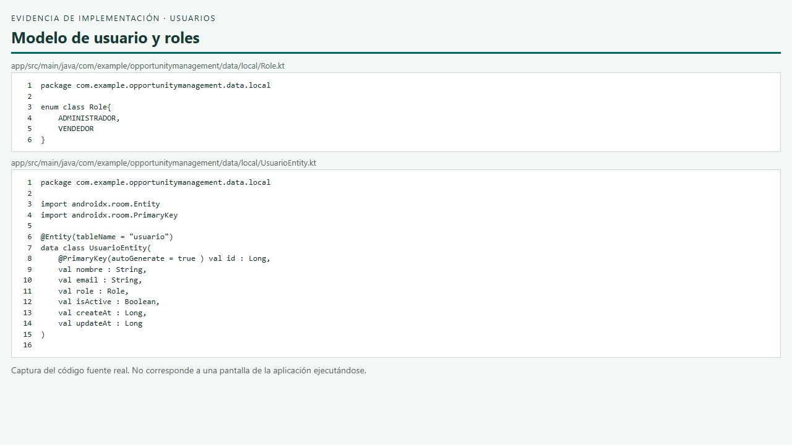

### DAO de usuarios

`UsuarioDao` contiene inserción, búsqueda por identificador y correo, observación del listado, actualización y activación o desactivación. Los retornos `Long`, entidad nullable e `Int` permiten comprobar el resultado de cada operación.

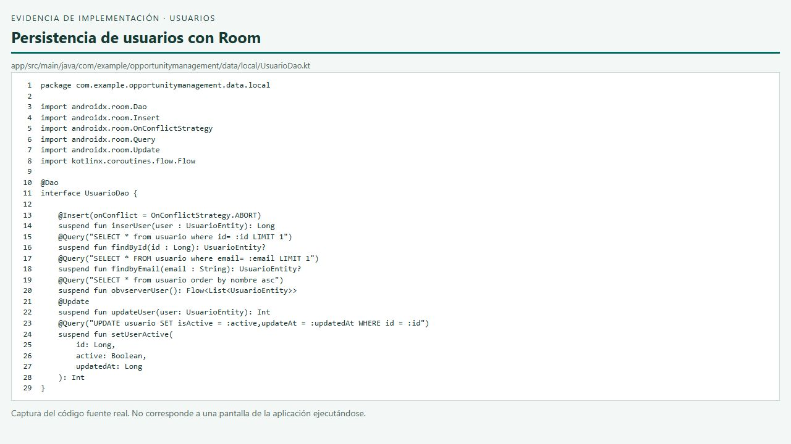

### Repositorio de usuarios

El repositorio centraliza las consultas, normaliza los correos, evita duplicados antes de insertar y transforma el número de filas actualizadas en un resultado booleano.

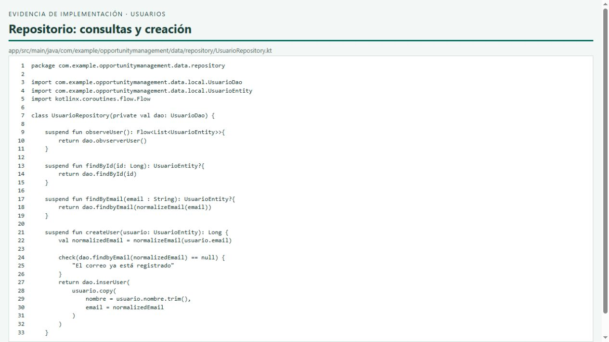

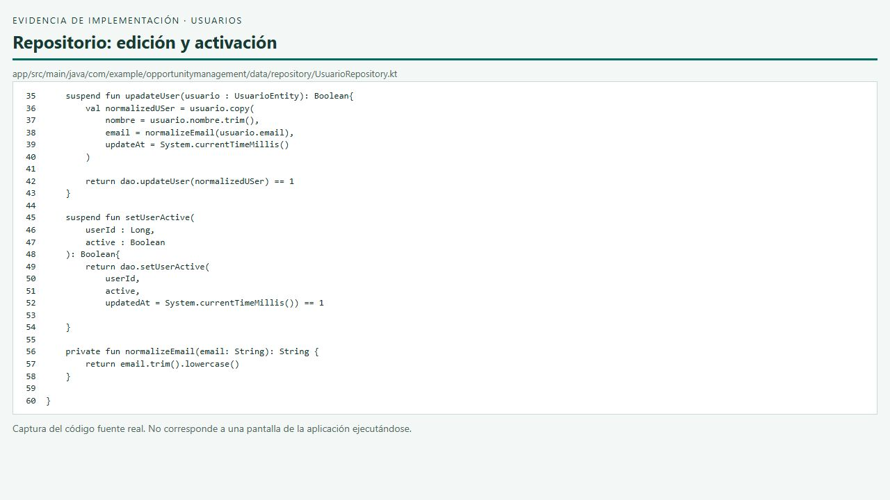

### UsuarioUiState independiente

Siguiendo la regla de arquitectura, `UsuarioUiState` está en su propio archivo dentro de `viewmodel`. Contiene valores del formulario, errores por campo y estados de carga y guardado. Las contraseñas están en el estado del formulario y no en `UsuarioEntity`.

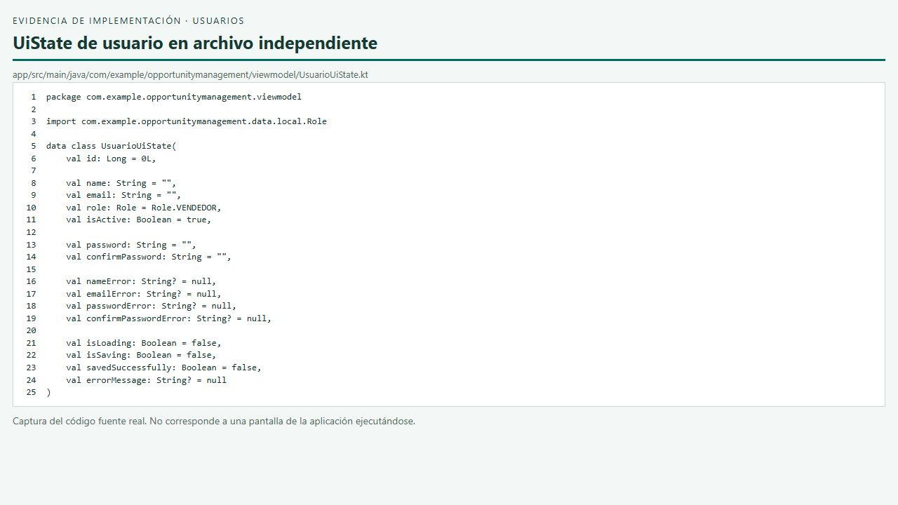

### UsuarioViewModel

El ViewModel expone `StateFlow`, procesa cambios de nombre, correo, contraseña y confirmación, y limpia los errores asociados cuando cambia cada campo.

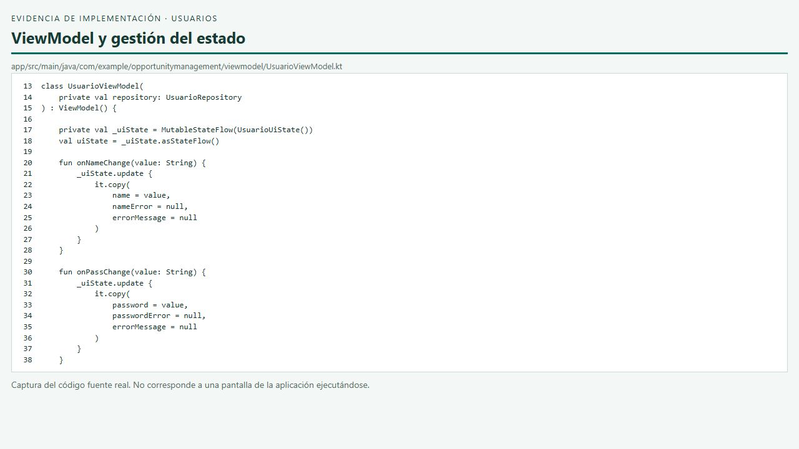

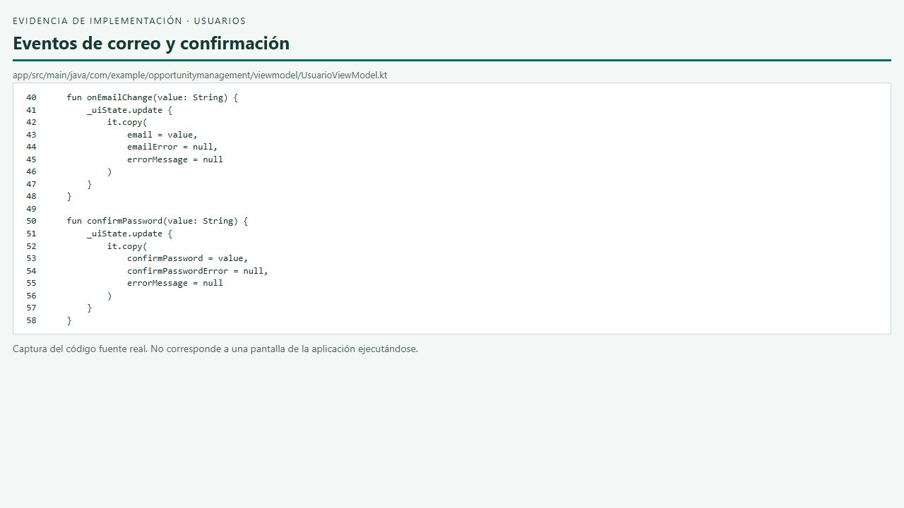

El registro evita envíos duplicados, valida el formulario, consulta si el correo ya existe, crea la entidad y comunica éxito o error mediante el UiState.

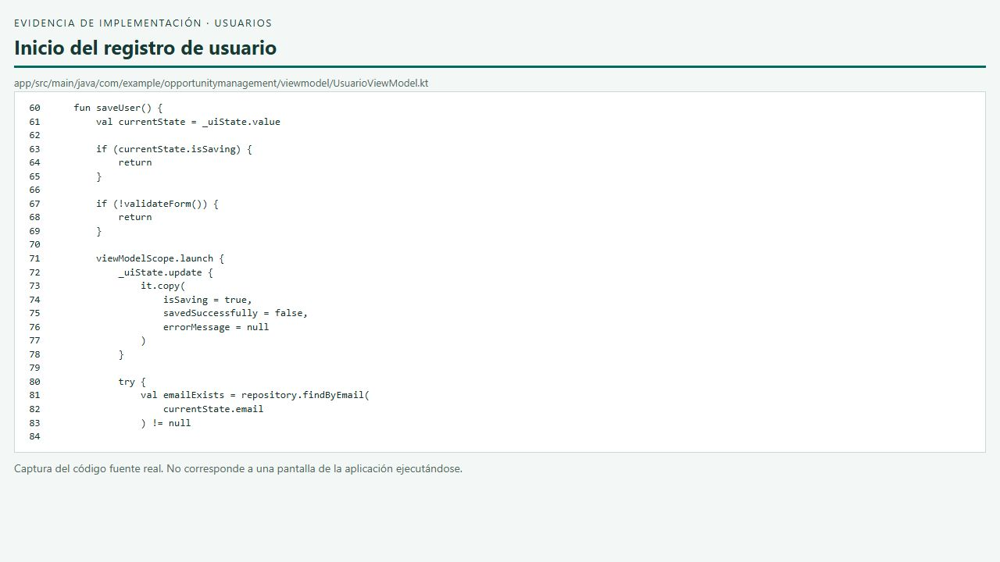

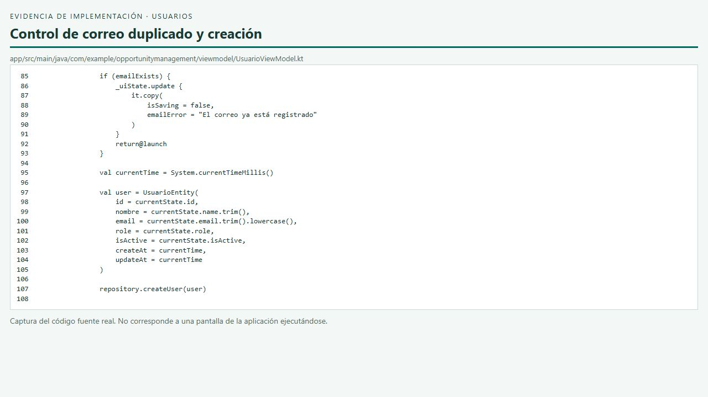

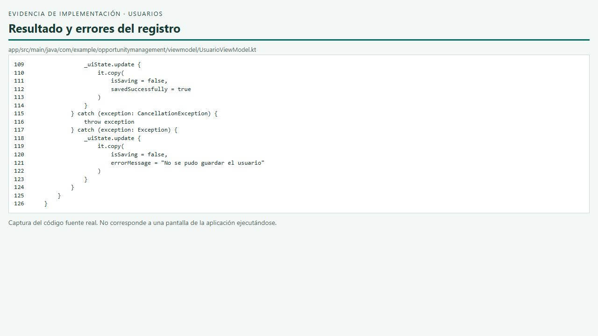

Las validaciones cubren nombre obligatorio, longitud mínima, formato de correo, contraseña mínima y confirmación coincidente.

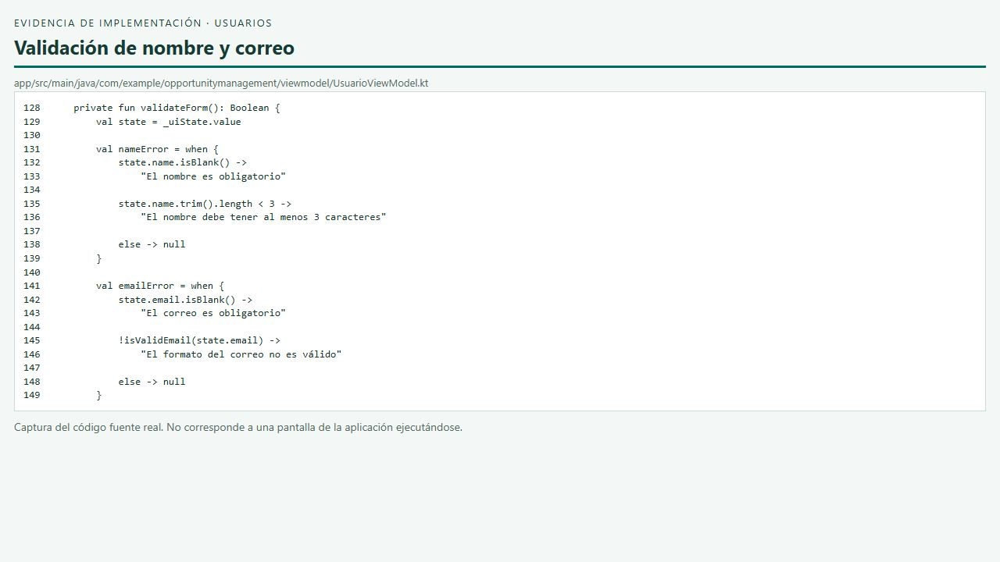

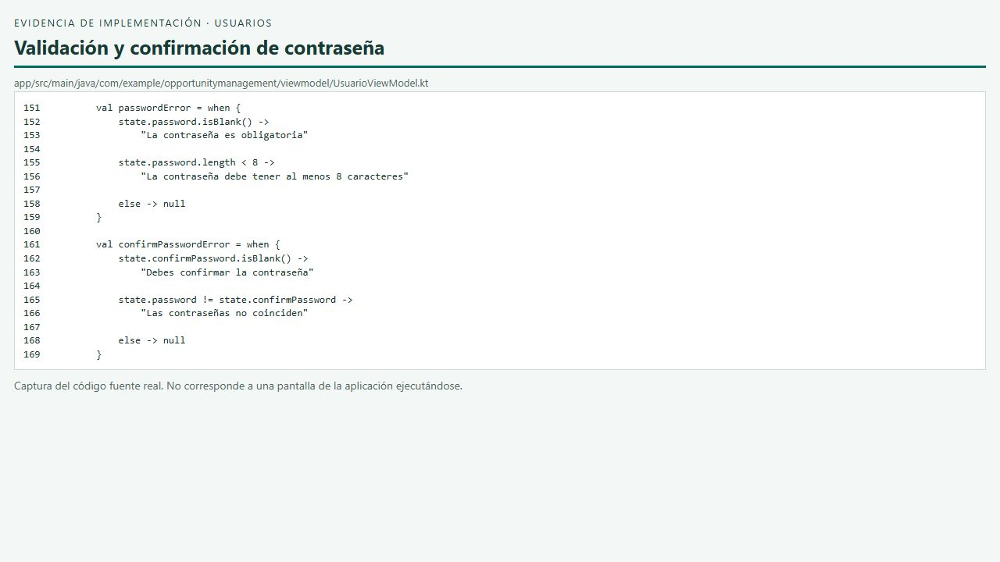

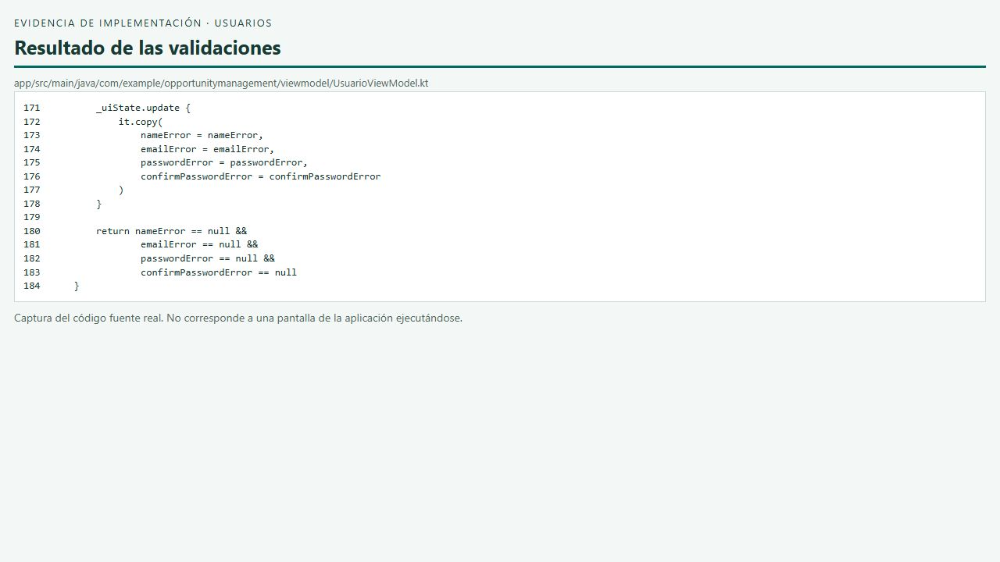

El ViewModel también permite cargar un usuario por identificador para una futura pantalla de consulta o edición y distingue un registro inexistente de un error inesperado.

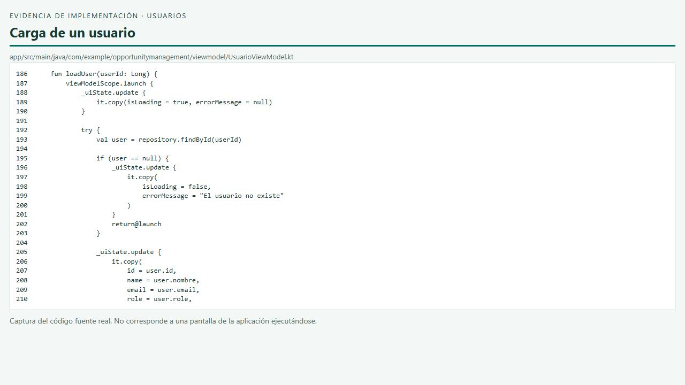

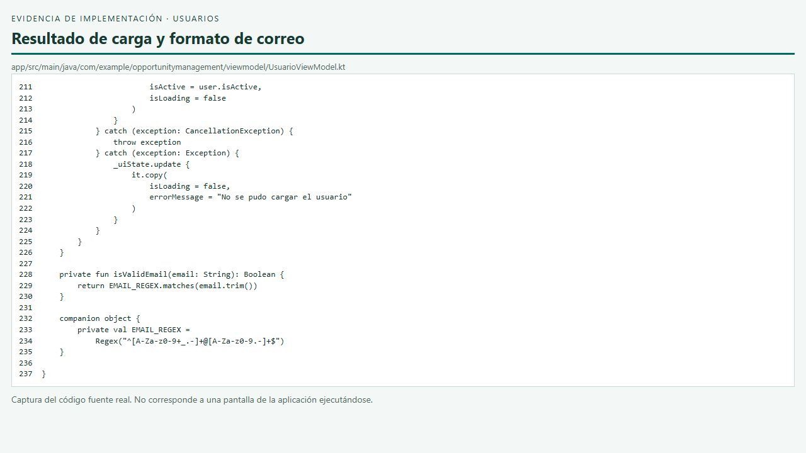

### Estado real de integración con Room

`AppDatabase` todavía contiene solamente `OportunidadEntity` y `OportunidadDao`. El módulo de usuarios no estará persistido hasta agregar `UsuarioEntity`, exponer `UsuarioDao` e implementar una migración de Room. Esta captura registra el estado actual sin presentarlo como completo.

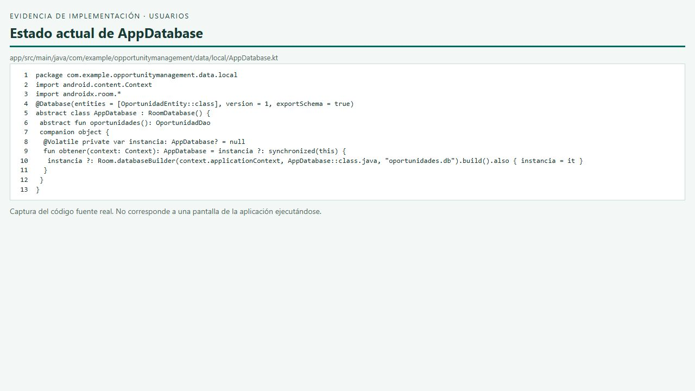

### Verificación realizada

Después de incorporar el módulo de usuarios se ejecutaron `assembleDebug` y `testDebugUnitTest`. La compilación terminó correctamente y se generó el APK. Las pruebas existentes pasan, pero aún no existen pruebas específicas del módulo de usuarios.

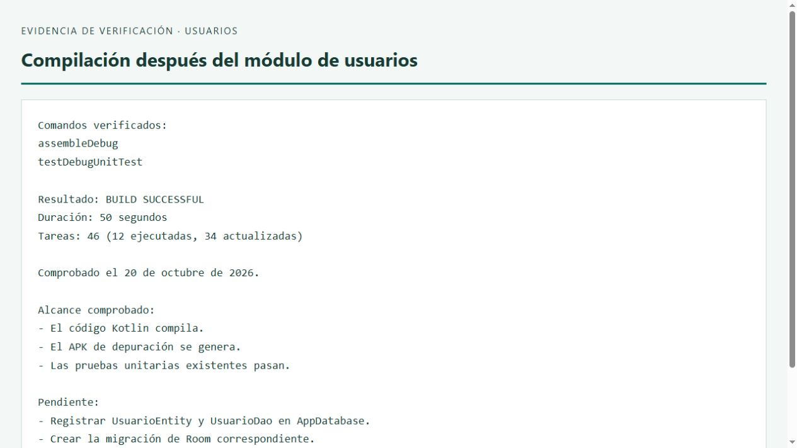

### Trabajo pendiente

- Registrar `UsuarioEntity` y `UsuarioDao` en `AppDatabase`.
- Crear la migración de Room antes de modificar la versión de la base de datos.
- Implementar credenciales sin almacenar contraseñas en texto plano.
- Separar `RegisterUiState`, `LoginUiState` y los ViewModels correspondientes.
- Crear las pantallas Compose de registro, inicio de sesión y administración, cada componente con `@Preview`.
- Añadir autorización por rol y pruebas unitarias e instrumentadas.

## Actualización: pantallas de autenticación — 20 de octubre de 2026

Las secciones anteriores conservan el estado histórico de cada entrega. En este
avance, Room ya incluye usuarios y credenciales en la versión 3.

Se crearon `LoginScreen` y `RegisterScreen`, con los colores y componentes de
Material 3 del proyecto, errores por campo, contraseñas ocultas con control de
visibilidad, estados de carga, desplazamiento y adaptación al teclado.
Todos los componentes nuevos tienen `@Preview`. `LoginUiState` y `RegisterUiState`
están en archivos separados dentro de `viewmodel`.

El registro asigna `Role.VENDEDOR` desde `AuthRepository.register()`. El formulario
no permite elegir administrador. El login verifica la contraseña, comprueba que
la cuenta esté activa y devuelve el rol guardado en `UsuarioEntity.role`.
Usuario y credencial se guardan en una única transacción para evitar cuentas
incompletas si ocurre un fallo.

`MainActivity` y `AppNavigation` quedan sin cambios: la conexión de rutas la hará
el autor del proyecto. La prueba muestra estas pantallas directamente en una
actividad de pruebas y utiliza una base de datos temporal en memoria.

Las capturas **30–38 sí corresponden a ejecución real en Android 14**, en el
emulador Pixel 7 API 34; las capturas 01–29 son las evidencias anteriores de código.

| Archivo | Evidencia |
| --- | --- |
| `30_login.png` | Formulario de inicio de sesión |
| `31_login_validation.png` | Validación de campos vacíos |
| `32_register.png` | Formulario de registro con cuenta de vendedor |
| `33_register_validation.png` | Validaciones del registro |
| `34_register_success.png` | Usuario y credencial creados |
| `35_login_error.png` | Rechazo de contraseña incorrecta |
| `36_login_success.png` | Inicio de sesión correcto |
| `37_login_loading.png` | Controles deshabilitados durante el acceso |
| `38_register_dark.png` | Registro con tema oscuro |

El registro de pruebas instrumentadas está en `auth-instrumentation.txt`.
La guía `../AUTHENTICATION.md` explica los callbacks y la preparación del repositorio
y los ViewModels para conectar la navegación.

Pendientes de integración: navegación, sesión compartida, primer administrador,
gestión administrativa y autorización de operaciones por rol. La compatibilidad
del `PasswordHasher` existente con API 24–25 también debe resolverse; las pruebas
de este avance se ejecutan en API 34.

## Actualización: tema verde y navegación con login y registro — 20 de octubre de 2026

En este avance se unificó el color de toda la aplicación con el verde petróleo
de las pantallas de inicio de sesión y registro, y se conectaron esas pantallas
a la navegación de producción. Las capturas **39–47 son del visor de código
fuente real**; las capturas **48–54 son de la aplicación ejecutándose** en el
emulador Pixel 7 API 34, iniciada desde `MainActivity`.

### Paleta verde del tema

**Implementación:** `Color.kt` reemplaza los colores morados de la plantilla
(`Purple40`, `PurpleGrey40`, etc.) por una paleta verde completa: primario
`#006B60`, secundario verde grisáceo, contenedores, fondos, superficies y
contornos con tinte verde, para el tema claro y el oscuro. Se conserva el ámbar
como color terciario.

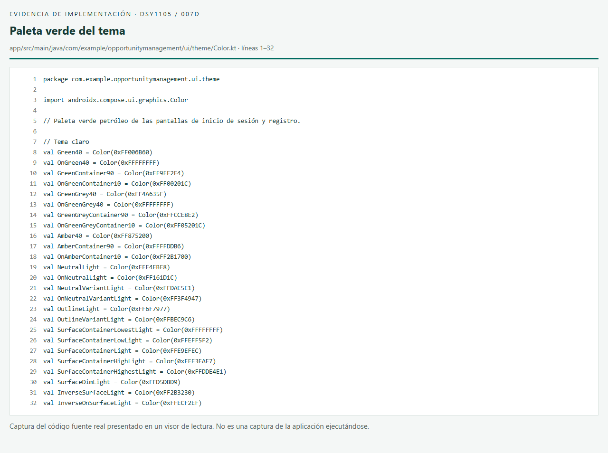

### Esquema de color de Material 3

**Implementación:** `LightColorScheme` y `DarkColorScheme` asignan todos los
roles de Material 3. Antes solo se definían `primary`, `secondary` y `tertiary`;
los demás roles (fondo, `secondaryContainer`, `surfaceContainerLow`…) usaban los
valores por defecto de Material, que son lavanda. Por eso tarjetas, fondos y
avisos se veían morados aunque el primario fuera verde.

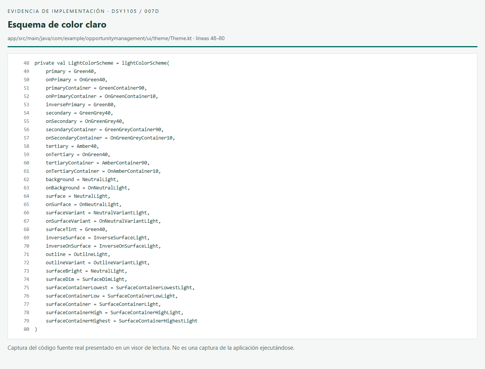

**Implementación:** el parámetro `dynamicColor` ahora es `false` por defecto.
En Android 12+ el color dinámico toma los colores del fondo de pantalla del
teléfono y reemplazaba el verde del proyecto.

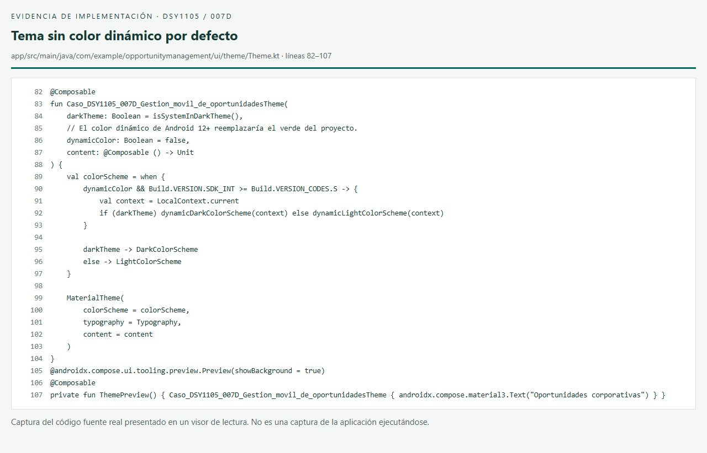

### Rutas de inicio de sesión y registro

**Implementación:** `AppNavigation` recibe `AuthRepository` y crea una única
`AuthViewModelFactory`. La ruta inicial pasa a ser `login`. Cada destino obtiene
su propio ViewModel con `viewModel(factory = authFactory)` y observa el estado con
`collectAsStateWithLifecycle`. Cuando `authenticatedUser` deja de ser `null`, un
`LaunchedEffect` guarda el nombre del usuario y navega al menú quitando `login`
de la pila. «Crear cuenta» abre `registro`; «Iniciar sesión» e «Ir a iniciar
sesión» vuelven a `login`.

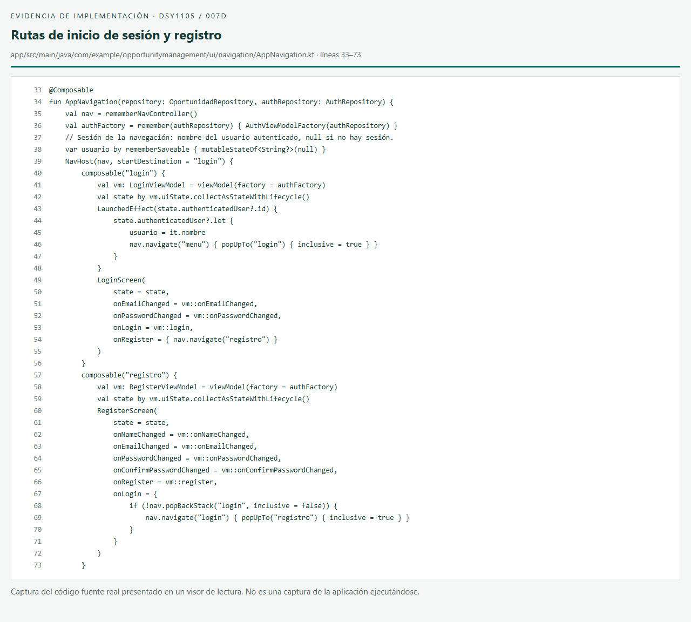

**Resultado y verificación:** `EntregaTest.flujoCompleto` recorre esta navegación
en el emulador y pasó.

### Menú y cierre de sesión

**Implementación:** el menú muestra el nombre del usuario autenticado. Al cerrar
sesión se limpia el usuario y se navega a `login` eliminando el menú de la pila,
por lo que el botón Atrás no permite volver al panel.

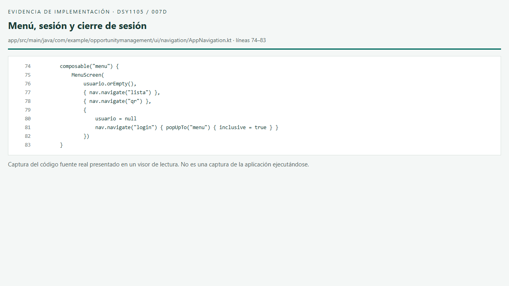

**Implementación:** `MenuScreen` recibe el nombre como parámetro, sin depender
del ViewModel ni de Room, y su `@Preview` usa un nombre de ejemplo. Se eliminó la
pantalla de acceso de demostración, que ya no se usa.

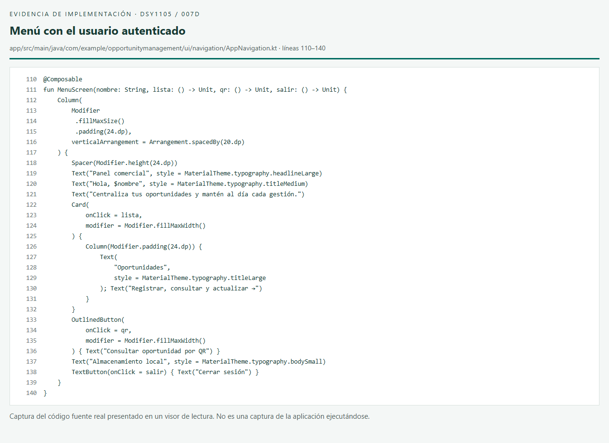

### Repositorio de autenticación en MainActivity

**Implementación:** `MainActivity` obtiene una sola instancia de `AppDatabase` y
crea con ella `OportunidadRepository` y `AuthRepository`, que se pasan a la
navegación.

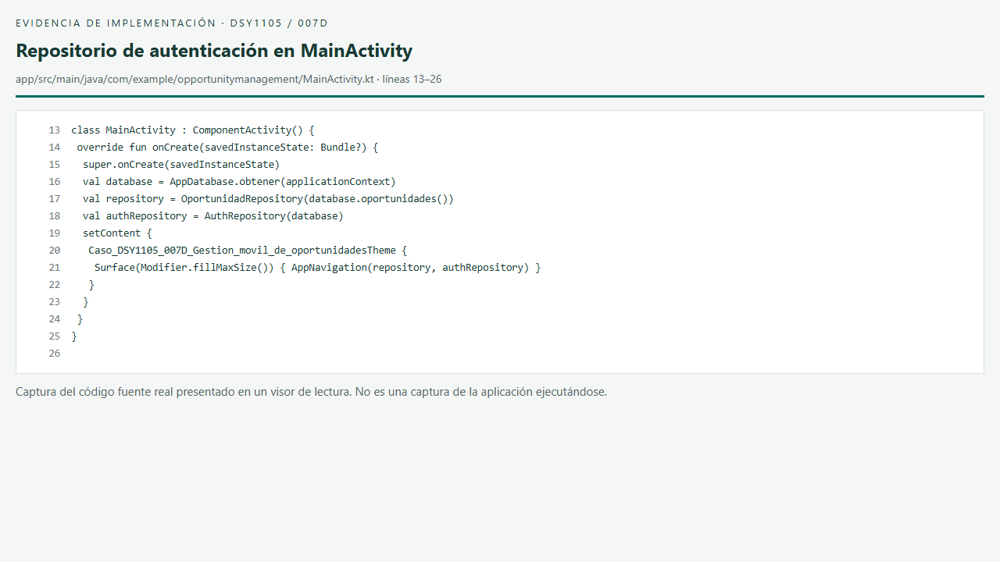

### Previews con el tema del proyecto

**Implementación:** los previews de navegación, lista, tarjeta, formulario y
campos usaban `MaterialTheme { }`, que muestra la paleta morada por defecto.
Ahora usan `Caso_DSY1105_007D_Gestion_movil_de_oportunidadesTheme`, igual que
la aplicación.

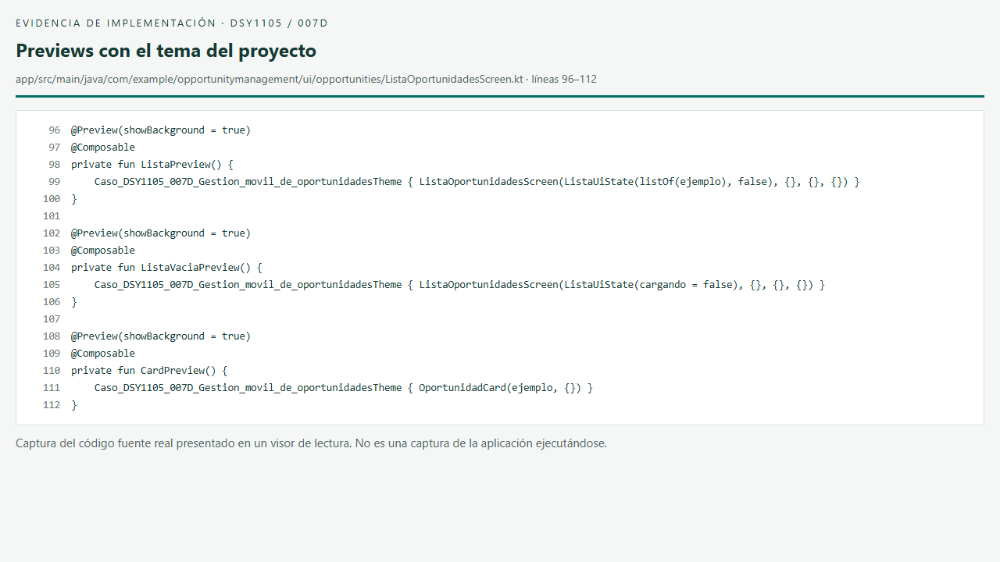

### Prueba del flujo completo

**Implementación:** como ya no existe el acceso de demostración, `flujoCompleto`
crea una cuenta de vendedor con un correo único, vuelve al login, inicia sesión
y continúa con el flujo de oportunidades y QR.

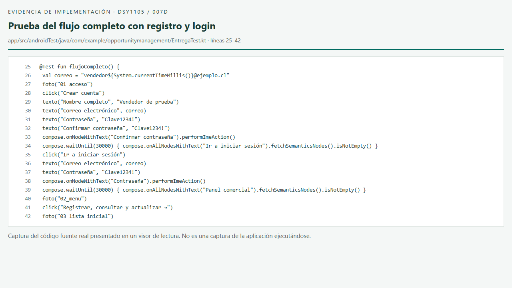

**Resultado y verificación:** pasaron 13 pruebas instrumentadas y 11 unitarias.
Detalle en `verificacion-tema-navegacion.txt`.

### Capturas de la aplicación ejecutada

| Archivo | Evidencia |
| --- | --- |
| `48_app_login.png` | Pantalla inicial: inicio de sesión |
| `49_app_registro.png` | Registro abierto desde «Crear cuenta» |
| `50_app_registro_ok.png` | Cuenta creada, botón «Ir a iniciar sesión» |
| `51_app_menu.png` | Menú con el nombre del usuario autenticado |
| `52_app_lista.png` | Listado de oportunidades con el tema verde |
| `53_app_formulario.png` | Formulario con validaciones y botones verdes |
| `54_app_logout.png` | Regreso al login después de cerrar sesión |

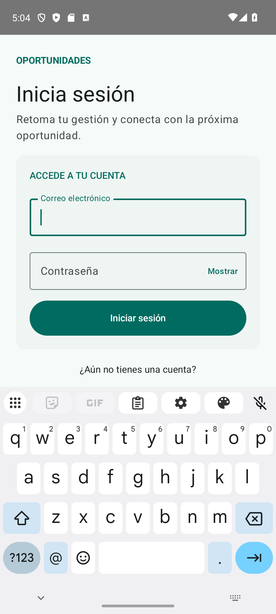

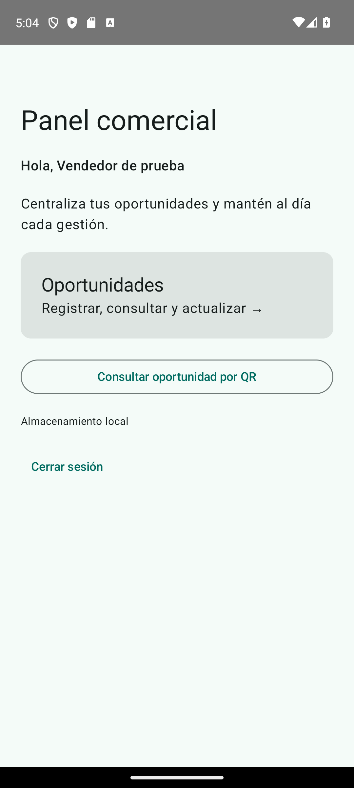

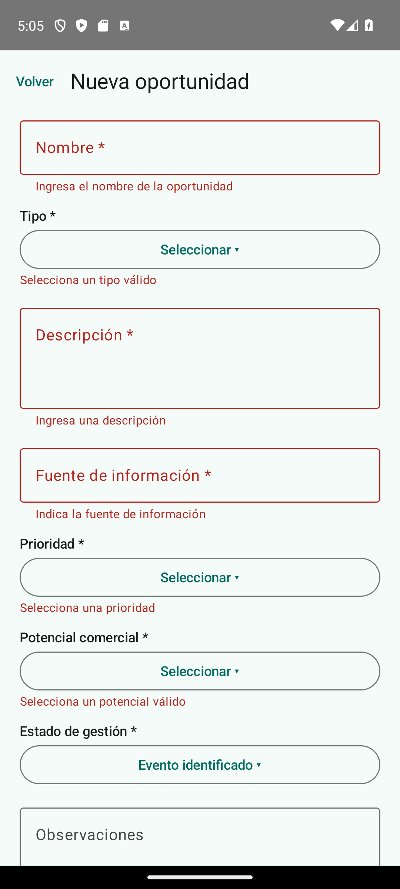

### Pendientes

- La sesión no persiste al cerrar la aplicación por completo; solo sobrevive
  a rotaciones y recreaciones de la actividad.
- Primer administrador, gestión de usuarios y autorización por rol siguen pendientes.
- Revisar los previews en Android Studio y probar en un teléfono físico.
